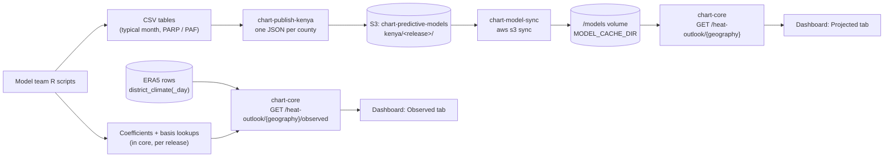

# From R output to the dashboard

This page explains how a model team's results reach the CHART dashboard. The
Kenya low birth weight (LBW) heat model and the under-five mortality
temperature model use this path, in two views:

- **Projected** reads the modelling team's pre-computed tables (typical months
  and period summaries for 2021–2100). CHART only filters and displays them.
- **Observed** scores a month that has already happened. CHART reads the ERA5
  temperatures it ingests for every county, moves them onto the models' scale
  and evaluates the modeller's DLNM in Python. No R runs; see
  [Observed months](#observed-months).



There is no Dagster job or R process on either path, and the tables are never
copied into the database. A county either has a published file or the API
returns `404 OUTLOOK_NOT_PUBLISHED`. Besides the ERA5 rows the observed view
reads, the only database read is the country's
[model settings](#model-settings), which narrow the options offered.

## How `chart-model-sync` works

`chart-model-sync` is a one-shot container in
`infra/aws/docker-compose.yml`. It runs the official AWS CLI image and copies
the model bucket onto a shared Docker volume:

```sh
aws s3 sync "s3://$MODEL_BUCKET/" /models/ --exclude "archive/*" --exclude "media/*" [--no-sign-request]
```

| Setting | Default | Meaning |
| --- | --- | --- |
| `MODEL_BUCKET` | `chart-predictive-models` | Bucket mirrored onto the volume. |
| `MODEL_BUCKET_PUBLIC` | `1` | `1` reads anonymously (`--no-sign-request`). `0` signs with the EC2 instance role, which needs `s3:ListBucket` and `s3:GetObject`. |
| `AWS_REGION` | `eu-west-2` | Region of the bucket. |

- **What it copies.** The whole bucket except `archive/` and `media/`. Both
  the `.rds` artifacts used by the live scorer and the outlook JSON files
  arrive this way. `media/` holds public web assets, such as the explainer
  video at `media/chart-explainer-16x9.mp4`, which browsers read straight
  from the bucket.
- **Where it lands.** The `chart-lbw-model` volume is mounted at `/models` in
  both `chart-lbw` (the R scorer) and `chart-core` (the API). Both containers
  set `MODEL_CACHE_DIR=/models`.
- **When it runs.** Whenever the stack is brought up. `chart-lbw` waits for it
  to finish successfully (`service_completed_successfully`), and `chart-core`
  starts after `chart-lbw` through the bootstrap step. A deployment therefore
  never serves files older than the bucket at deploy time.
- **Idempotency.** `aws s3 sync` copies only new or changed objects, so
  re-running it is cheap and safe.
- **Updating without a deploy.** Run the container again with
  `docker compose run --rm chart-model-sync`. The API reads each file's
  modification time and picks up new content without a restart.

Locally, there is no sync. `MODEL_CACHE_DIR` defaults to `pipelines/models/`,
and `chart-publish-kenya` writes there by default, so the layout matches the
bucket. `pipelines/models/kenya/` is git-ignored.

## Bucket layout for the outlook

```text
s3://chart-predictive-models/kenya/<release>/
  lbw/<county>.json                 46 counties
  lbw/kenya.json                    national period summary
  under_5_mortality/<county>.json
  under_5_mortality/kenya.json
```

The release folder sits beside `kenya/lbw/` and `kenya/under-five-mortality/`,
which hold the live scorer's R model files; the `v…` name tells them apart.
`<release>` is the modeller's version label, for example `v2_2026_10_06`. The
API reads the release named by `CHART_KENYA_OUTLOOK_RELEASE`, which defaults to
the current one in `chart/heat_outlook/service.py`. Publishing a new release
never overwrites an old one, and switching back is one environment variable.

County file names are the county name in lower case, with apostrophes removed
and other punctuation turned into hyphens (`Murang'a` → `muranga`,
`Taita Taveta` → `taita-taveta`). They match the `geo-ke-<county>` geography
IDs.

## Publishing a new release

1. Receive the model team's `model_files/` folders for LBW and under-five
   mortality.
2. Run the publish script. It reads the CSVs, reshapes them and writes the
   JSON files:

    ```sh
    chart-publish-kenya \
      --lbw-dir path/to/LBW_.../model_files \
      --u5-dir path/to/U5_.../model_files \
      --release v2_2026_10_06
    ```

3. Check the dashboard locally against the developer guides' tables. For
   example, check the national whole-pregnancy PARP for 2041–2060 under
   SSP5-8.5.
4. Upload with `--upload`, which runs
   `aws s3 sync <out> s3://chart-predictive-models/kenya/<release>/`.
   This needs write credentials for the bucket.
5. If the release label changed, set `CHART_KENYA_OUTLOOK_RELEASE` and
   redeploy, or rerun `chart-model-sync`.

The script uses only these input files:

| Outcome | Files |
| --- | --- |
| LBW | `lbw_tmax_dlnm_national_no_altitude.json`, `typical_month_heat_LBW_dlnm_county.csv`, `PARP_heat_dlnm_county_by_period.csv`, `PARP_heat_dlnm_national_by_period.csv`, `exposure_response_curves_by_window.csv` |
| Under-five | `u5_tmax_dlnm_models.json`, `typical_month_u5_county.csv`, `PAF_u5_county_by_period.csv`, `PAF_u5_national_by_period.csv` |

## What the dashboard shows

On Kenyan places the dashboard's risk panel has two tabs, **Observed** and
**Projected**, under one question: what share of cases may be attributable to
heat exposure. It opens on Observed when the place has a month to show, and on
Projected otherwise. Planning for Kenya opens on Kenya as a whole, and the
reader picks a county on the map or in the context bar. While a new month,
county or choice loads, the previous figures stay on screen, dimmed.

Both tabs show the same elements:

| Element | Source |
| --- | --- |
| Icon array | The share, rounded, as filled figures out of 100 |
| Sentence | Share with its 95% CI (or climate-model range), when, place |
| Ratio | Odds ratio (LBW) or risk ratio (under-five) with 95% CI, converted from the share and its bounds (below) |
| Precision badge | The ratio's CI, on the health team's thresholds (high ≤ 2.5, moderate ≤ 5, low above) |
| Map | Every county shaded by the same figure |

Controls shared by both tabs: **pregnancy window** (LBW; whole pregnancy by
default, and the only window offered until the trimesters are switched on in
[model settings](#model-settings)) or **age group** (under-five;
post-neonatal by default, as agreed with the modeller on 2026-10-08).

**Observed** adds a **month** grid with a year picker. Only months that can be
scored are enabled, and each is tinted by its share, so the riskiest months
stand out. The figures are described in [Observed months](#observed-months);
"Temperatures behind this estimate" lists the inputs on both scales.

**Projected** adds:

| Control | Options | Default |
| --- | --- | --- |
| Scenario | The file's scenarios | SSP5-8.5 |
| Time horizon | The file's 20-year periods; the first is the baseline (1981–2010 for LBW, 1991–2020 for under-five) | 2041–2060 |
| Reference period | **Annual average**: the period summary (PARP for LBW, PAF for under-five) with its 95% CI and the change from the baseline. **Peak heat season**: the three consecutive months with the highest heat share in the typical-month table, with the climate-model range (the table has no CI per month) | Annual average |

The peak season is ranked by share, not by temperature. An LBW month is the
births of that month, exposed over the pregnancy before it, so the births heat
affects most are not born in the hottest months: in Kajiado they are born in
July to September, after the January–March heat. For under-five, with four-day
lags, the two orders agree. Kenya as a whole has no typical-month table, so
the peak season is not offered there.

One-, five- and ten-year horizons need monthly projections from the modelling
team, which are not in this release; the panel says so under the controls.

**Ratio conversion.** Both guides define the share as AF = 1 − 1/RR. Under-five
is a case-crossover design, so the odds ratio is the risk ratio:
RR = 1 / (1 − AF). For LBW the guide converts OR to RR with Zhang–Yu and the
fitted LBW proportion p0 (published in each file), so
OR = RR (1 − p0) / (1 − p0 RR). The same transform is applied to both CI
bounds. Where it has no inverse (p0 RR ≥ 1) no ratio is shown.

The guides' display rules are applied in the API, so a suppressed value
arrives as `null` with the message to show in its place:

| Case | Shown instead of a share |
| --- | --- |
| LBW 3rd trimester, or any negative LBW share | "No excess heat risk estimated for this window (estimate below 1, compatible with no effect)." |
| Neonatal heat | "No heat-related excess in newborn deaths was found; risk was higher on cooler days." The ratio and its CI are still shown. |
| Other negative under-five shares | "No heat-related excess estimated" or "No excess on cooler-than-usual days" |
| Post-neonatal, infant, child, under-5 | Noted as "Approximate death dates." |
| More than 10% of months or days above the 99th percentile | "Estimate relies partly on temperatures rarely seen in the fitting data." |

On the map, a suppressed county is drawn near-white with its own legend entry,
**No heat excess**, so it is not read as low risk. A choice with no period
summary (the 3rd trimester) shows every county as "Not reported", and a county
with no published file as "Not integrated".

**3rd-trimester odds ratio by month.** The tables carry no per-county
odds ratio for the 3rd trimester. The seasonal pattern reads it from the
modeller's national T3 exposure-response curve at the hottest of the three
trimester months for that county, scenario and period: the worst case. Below
the minimum-risk temperature it is 1.

## Observed months

`GET /heat-outlook/{geography}/observed?outcome=&month=YYYY-MM&selector=`
scores one month for a county (`geo-ke-<county>`) or for Kenya (`geo-ke`, the
mean over its counties); `.../observed/map` returns every county for the same
month.

**Models.** The coefficients, covariance and cross-basis lookups of the
2026-10-06 hand-over ship with `chart-core`, in
`core/chart/heat_outlook/releases/<release>/` (`lbw_model.json`,
`lbw_basis_lookup.csv`, `u5_models.json`, `u5_basis_lookup.csv`).
`chart/heat_outlook/dlnm.py` is a plain-Python port of the modeller's
reference scorers; `core/tests/test_kenya_observed_api.py` holds it to his
validation cases from R (within 1e-3; in practice 3e-5 for LBW and 6e-5 for
under-five).

**Inputs.**

| Outcome | A month M is scored on | Shown when |
| --- | --- | --- |
| LBW | The monthly mean daily Tmax of M and the eight months before it (lag 0 is the birth month), heat only: months below the national minimum-risk temperature (24.3 °C) count as it | All nine months are complete ERA5 months (`observed_days == expected_days`) |
| Under-five | Every day of M on that day and the three before it, against the county's 1991–2020 mean daily Tmax; the month is the mean of its days' shares, as on India's day-grain path (`trailing_window_mean`) | Every day of M and the three days before it are present |

Only ERA5 rows (`data_label` observed or reanalysis) are used, the newest run
for each month or day. The 95% CI comes from the model's covariance; for
under-five it is the mean of the days' bounds.

**Scale (calibration).** The models were fitted on a 0.1° daily Tmax product
(`Kenya_Combined_rasters`; the guide says "most likely ERA5-Land, to be
confirmed"), not on ERA5. Over the same years, 2011–2020, CHART's ERA5 county
means run warmer than the model's temperatures: by about 1 °C on average, by
2–2.6 °C in Baringo, Embu, Kitui and Samburu, and by up to 4 °C in some months.
Scored as they are, they would overstate heat risk. Each ERA5 value is therefore shifted by a fixed offset per county
and calendar month:

```text
offset(county, month) = model-scale mean Tmax 2011–2020 (typical-month table, mean of its scenarios)
                      − ERA5 mean Tmax 2011–2020 (same pipeline and county averaging as the live pulls)
```

This keeps ERA5's departure from its own climate, which is what an anomaly
method uses. The hand-over's ISIMIP offsets do not fit ERA5 (correlation −0.15
with the gap), so they are not used. The offsets are in `calibration.json`
next to the models, with the ERA5 history they came from
(`era5_tmax_monthly_2011_2020.csv`, 45 counties × 120 months; Mombasa and
Vihiga are too small to hold an ERA5 grid point and have no live ERA5 either, and Narok is not
in the modeller's tables). Regenerate them for a
new release with:

```sh
DATABASE_URL=... python core/scripts/kenya_era5_climatology.py era5_2011_2020.csv
chart-publish-kenya --lbw-dir .../LBW_.../model_files --u5-dir .../U5_.../model_files \
  --release <release> --era5-climatology era5_2011_2020.csv
```

Without `calibration.json` the observed view is not offered.

**Which months.** A county offers every month it can score. Kenya offers a
month only when at least half its counties can score it: the newest ERA5 pull
often reaches a few counties first, and the national figure would otherwise
stand on a handful. A county opens on the newest month Kenya can show, if it
has it, so the map beside it is full; its own newer months stay selectable.
The map accepts any month a county can score and shows the others as
unavailable.

The display rules below apply to observed months as to projected ones.

## Model settings

Settings → Workspace → **Model options** chooses, per country and outcome
(for example Kenya + LBW, Kenya + under-five, India + LBW), which options CHART
offers. One country is shown at a time: a picker in the card's header (opening
on the planning location's country) chooses it, and each outcome below it has
its own Save.

| Setting | Options come from | Default |
| --- | --- | --- |
| Pregnancy windows (LBW) or age groups (under-five) | The outlook file's selectors (`P`, `T1`–`T3`; the age groups), and each live release's validated windows (`window_1`–`window_3`) | LBW outlook: whole pregnancy only. Age groups and live windows: all on. Default selector: whole pregnancy / post-neonatal |
| Scenarios, with one default | The outlook file's scenarios; SSP1-2.6, SSP3-7.0 and SSP5-8.5 for live places with a hot season | All on, SSP5-8.5 by default |
| Data views | `observed` (Copernicus ERA5 months) for the Kenya outlook when its release has a calibration, and wherever a live release is active; `seasonal` (C3S forecast, up to 6 months) for live releases; `projection` (long-term scenarios) for the outlook and live places with a hot season | All on |

The rules are enforced by the API (`PUT /model-settings/{country}/{outcome}`),
not by the page:

- **Narrow only.** A setting can switch off an option, never add one. A code
  the tables or releases do not offer is refused with
  `422 MODEL_SETTINGS_OPTION_UNKNOWN`.
- **Never empty.** Each view (outlook, live) keeps at least one option in each
  list, and every live place keeps at least one of its validated windows
  (`422 MODEL_SETTINGS_OPTION_REQUIRED`).
- **The default is on.** The default window or age group and the default
  scenario must be switched on, and where the outlook uses them they must be
  outlook options (`422 MODEL_SETTINGS_DEFAULT_NOT_ENABLED` or
  `MODEL_SETTINGS_DEFAULT_REQUIRED`).
- **Applied server-side.** `GET /heat-outlook/...` lists only the options
  switched on, opens on the configured defaults, and refuses a disabled one
  with `422 OUTLOOK_SELECTION_INVALID`, like any other invalid selection. A
  view switched off (`observed` or `projection` on the outlook) answers
  `404 VIEW_TURNED_OFF`, and the dashboard disables its tab.
  `GET /climate/planning-options/{geography}` drops disabled windows and
  scenarios, withdraws long-term projections when `projection` is off, and
  marks the next-months choices `MODEL_DATA_MODE_DISABLED` when `seasonal` is
  off. `POST /climate/predict` refuses a disabled data mode, scenario or
  window with `409 MODEL_DATA_MODE_DISABLED`, `MODEL_SCENARIO_DISABLED` or
  `MODEL_PREGNANCY_WINDOW_DISABLED`.
- **No row, no change.** Without a saved row the defaults above apply, which
  match the previous behaviour except that the LBW outlook hides the
  trimesters. If a newer release stops offering a saved option, that option is
  dropped; if what remains breaks a rule, the defaults apply until someone
  saves again.
- **Who may change them.** Any signed-in user who can read the country path
  (for example `/kenya`) may read and change them; roles are intentionally not
  restricted yet. The card sits on the Settings Workspace tab, which every
  signed-in user with a planning area can open.
- **Audit.** Every change writes an `audit_event` row of type
  `model_settings_changed` with the country, the outcome and the values before
  and after. It appears in the user's activity log.

Settings live in `model_display_setting` (migration
`027_model_display_settings`), one row per country and outcome. Resetting the
installation deletes them. The live dashboard scores model window 1, so
switching window 1 off stops monthly predictions for that country.

## Known gaps

- **Narok.** Narok county is not in the v2_2026_10_06 tables, so its page
  shows "No outlook has been published".
- **Sub-counties.** The constituency-level tables exist but are not
  published. CHART does not yet have the 290 constituency boundaries.
- **Counts.** There are no births or deaths counts, so only percentages are
  shown, never attributable numbers. Kenya's observed figure is the plain mean
  of its counties for the same reason.
- **Temperature product.** The calibration stands in for scoring on the
  fitting product itself. Once the modeller confirms it (ERA5-Land or other),
  pulling that product would remove the offset.
- **Short horizons.** One-, five- and ten-year projections wait for the
  modeller's monthly projection outputs.

## Relation to the live scorer

The older path scores each month on request: Dagster calls the R scorer and
writes `prediction_result`. It still runs, and the panel above it on the
dashboard still uses it. The outlook does not depend on it. Retiring the live
path is a separate change.
